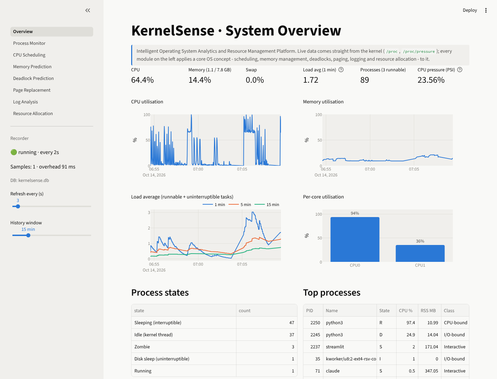
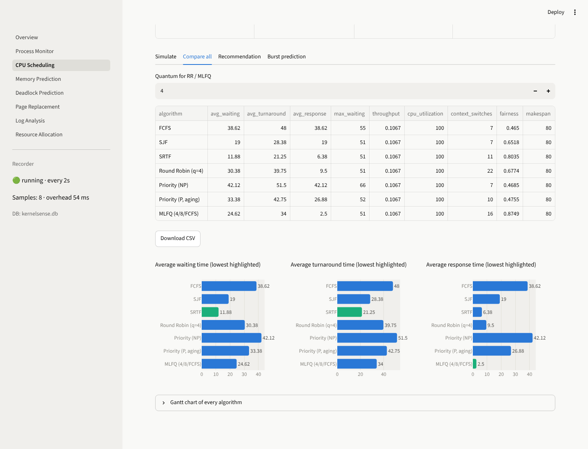
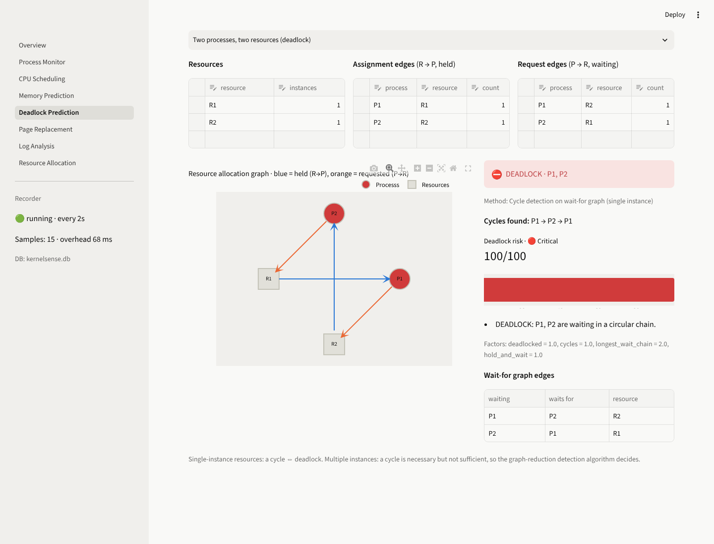
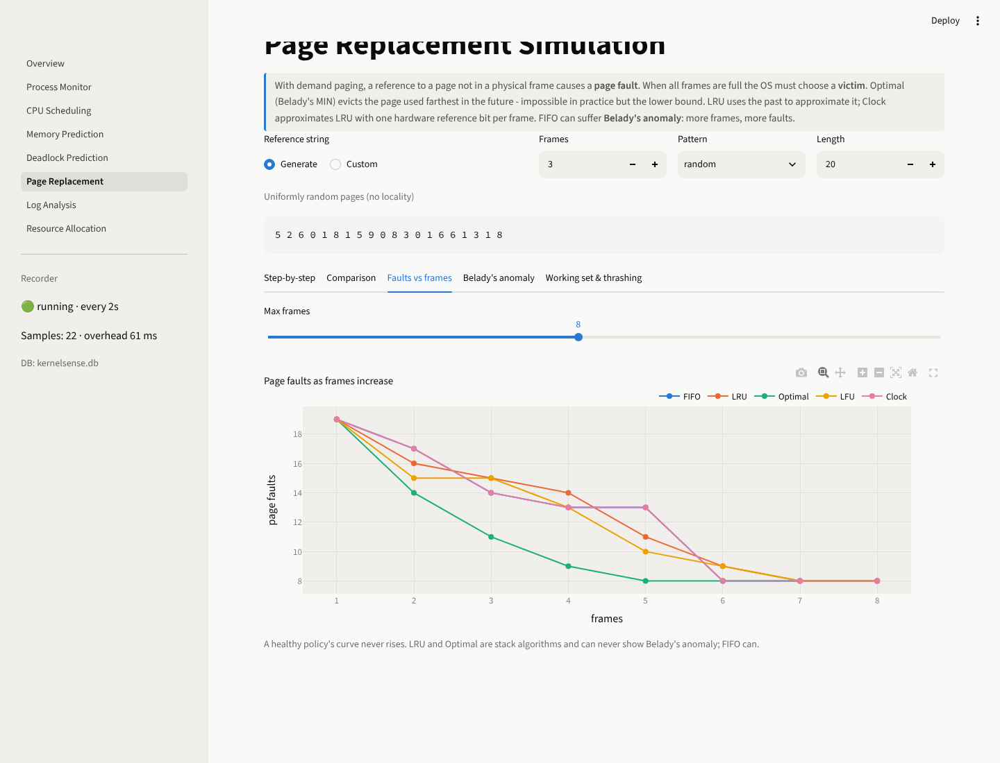
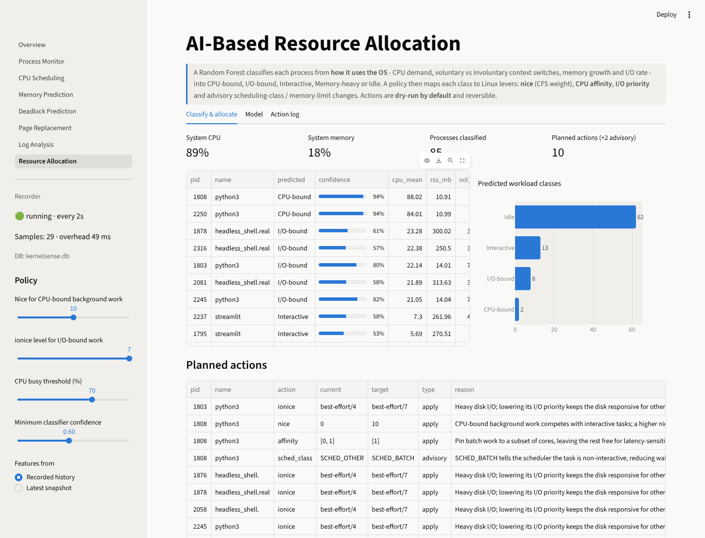

# KernelSense

**Intelligent Operating System Analytics and Resource Management Platform** — a Python platform that reads live data
from the Linux kernel, applies classical OS algorithms to it, predicts resource behaviour with machine learning and
acts on running processes through real OS controls.



| Module | OS concepts | What it does |
|---|---|---|
| **Process Monitoring** | PCB, process states, fork/exec tree, context switches, page faults, PSI | Live process table and tree read from `/proc`, workload classification from voluntary vs involuntary context switches, anomaly detection (zombies, D-state, orphans, fork storms, FD/thread leaks) |
| **CPU Scheduling Recommendation** | FCFS, SJF, SRTF, Round Robin, Priority + aging, MLFQ, burst prediction | Discrete-event simulator with Gantt charts and full metrics, goal-based recommender (workload rules + simulation-validated ranking), exponential-average burst predictor, Linux mapping |
| **Memory Usage Prediction** | Virtual memory, RSS, page cache, swap, OOM killer | Forecasting (naive, moving average, linear trend, Holt) evaluated against a baseline, prediction intervals, time-to-exhaustion alerts, per-process leak detection |
| **Deadlock Prediction** | Coffman conditions, Banker's algorithm, RAG, wait-for graph | Safety and resource-request algorithms with traces, single/multi-instance detection, deadlock risk scoring, live `/proc/locks` wait-for graph |
| **Page Replacement Simulation** | Demand paging, FIFO, LRU, Optimal, LFU, Clock, Belady's anomaly, working set | Step-by-step frame tables, fault curves across frame counts, automatic Belady's anomaly search, thrashing assessment |
| **Log Analysis** | Kernel ring buffer, syslog/journald, OOM/segfault/hung-task/I-O error events | Multi-format parser, OS event rules with explanations, Isolation Forest + robust z-score anomaly detection on time windows |
| **Performance Dashboard** | — | Streamlit dashboard with a live overview and one page per module |
| **AI-Based Resource Allocation** | CFS weights (nice), CPU affinity, I/O priority, scheduling classes | Random Forest workload classifier, policy that maps classes to Linux levers, safe actuator (dry-run, allow-list, rollback, audit log) |

<table>
<tr>
<td></td>
<td></td>
</tr>
<tr>
<td></td>
<td></td>
</tr>
</table>

---

## Architecture

```
┌──────────────────────────────────────────────────────────────────────┐
│ Interfaces   Streamlit dashboard (Overview.py + pages/)  ·  CLI        │
├──────────────────────────────────────────────────────────────────────┤
│ Actuator     nice · CPU affinity · ionice   (dry-run, allow-list,      │
│              rollback, JSON action log)                                │
├──────────────────────────────────────────────────────────────────────┤
│ Engines      scheduling · memory · deadlock · paging · logs · allocator│
├──────────────────────────────────────────────────────────────────────┤
│ Storage      SQLite time-series store (system + per-process metrics)   │
├──────────────────────────────────────────────────────────────────────┤
│ Collectors   /proc/[pid]/{stat,status} · /proc/loadavg · /proc/pressure│
│              /proc/locks · journald · syslog · dmesg   (+ psutil)      │
└──────────────────────────────────────────────────────────────────────┘
                               Linux kernel
```

Design rules:

* **The UI holds no OS logic.** Every algorithm lives in the `kernelsense` package; the dashboard and CLI only call it.
* **Pluggable interfaces.** `Collector`, `Scheduler`, `ReplacementPolicy` and `Forecaster` are base classes, so new
  policies or a pure-`/proc` collector can be added without touching the rest.
* **Graceful degradation.** A capability probe checks for PSI, cgroup v2, `/proc/locks`, journald and syslog; missing
  interfaces are skipped instead of failing.
* **Safe by default.** Resource actions are simulated unless explicitly enabled and never touch system processes or
  other users' processes.

---

## Getting started

Requirements: **Linux** (native, VM or WSL2) and **Python 3.10+**.

```bash
git clone https://github.com/Kislay01/Intelligent-Operating-System-Analytics-and-Resource-Management-Platform.git
cd Intelligent-Operating-System-Analytics-and-Resource-Management-Platform
python3 -m venv .venv && source .venv/bin/activate
pip install -r requirements.txt

streamlit run Overview.py
```

Open http://localhost:8501. The dashboard starts a background recorder that samples metrics every 2 seconds into
`data/kernelsense.db`; forecasting and leak detection improve as history accumulates.

### WSL2 notes

Everything runs on WSL2. For the fullest experience:

* enable systemd (for journald logs): add `[boot]` / `systemd=true` to `/etc/wsl.conf`, then `wsl --shutdown`
* check PSI support with `cat /proc/pressure/cpu` — if it is missing, PSI metrics show "n/a"
* only processes inside the WSL VM are visible (Windows processes are not)

### Configuration

| Variable | Default | Meaning |
|---|---|---|
| `KS_SAMPLE_INTERVAL` | `2` | seconds between samples |
| `KS_RETENTION_HOURS` | `24` | how long metrics are kept |
| `KS_MEM_ALERT_PCT` | `90` | memory alert threshold |
| `KS_DRY_RUN` | `1` | set to `0` to let the CLI apply resource actions |
| `KS_DATA_DIR` | `./data` | database, model and action log location |

---

## Live demo

The `workloads/` folder contains small programs that create the situations each module detects:

```bash
bash workloads/run_demo.sh 180        # start everything for 3 minutes
```

| Workload | What to look at |
|---|---|
| `cpu_hog.py` | Classified **CPU-bound**; Resource Allocation plans a higher nice value and core pinning |
| `memory_leak.py` | Memory Prediction → **Leak detection** flags it; classifier labels it **Memory-heavy** |
| `io_heavy.py` | Classified **I/O-bound** (voluntary switches, high disk rate); ionice action planned |
| `zombie_maker.py` | Process Monitor → **Anomalies** shows zombie children |
| `lock_deadlock.py` | Deadlock → **Live system** shows a real circular wait in `/proc/locks` |

Suggested demo flow: Overview → Process Monitor (classes + anomalies) → CPU Scheduling (convoy profile, Compare all,
Recommendation) → Page Replacement (Belady's anomaly) → Deadlock (textbook Banker's request, dining philosophers,
live lock deadlock) → Memory Prediction (leak) → Log Analysis (sample source) → Resource Allocation (dry run, apply,
roll back).

---

## Command-line interface

```bash
python -m kernelsense status                                   # snapshot, top processes, anomalies
python -m kernelsense record --interval 2 --duration 600       # record metrics without the dashboard
python -m kernelsense schedule --profile convoy --goal interactive [--practical]
python -m kernelsense paging --refs "1 2 3 4 1 2 5 1 2 3 4 5" --frames 3
python -m kernelsense bankers --request "P1 1 0 2"
python -m kernelsense logs --source auto                       # journald | syslog | dmesg | sample
python -m kernelsense allocate            # plan only (dry run)
python -m kernelsense allocate --apply    # apply nice / affinity / ionice to your own processes
```

---

## Module details

### 1. Process Monitoring
Reads `/proc/[pid]/stat` (state, minor/major faults), `/proc/[pid]/status` (context switches), `/proc/loadavg` and
`/proc/pressure/*`. CPU% is computed from CPU-time deltas between samples. Each process is classified from its
context-switch behaviour: involuntary switches dominate for CPU-bound work (preempted by the scheduler), voluntary
switches dominate for I/O-bound and interactive work (the process blocks).

### 2. CPU Scheduling Recommendation
Six policies share one `Scheduler` interface and produce Gantt segments and per-process statistics (waiting,
turnaround, response) plus throughput, CPU utilisation, context switches and Jain's fairness index. The recommender
characterises the workload (burst variability, convoy risk, priority spread, share of short jobs), simulates every
candidate and ranks them for the chosen goal (balanced, interactive, throughput, fairness). "Practical only" excludes
SJF/SRTF, which need future burst knowledge. Results are verified against textbook examples in the tests.

### 3. Memory Usage Prediction
Recorded memory history is resampled to a regular grid and four forecasters are compared on a held-out window
(MAE/RMSE/MAPE and improvement over the naive baseline). The best one produces a forecast with a widening 95%
interval and an estimate of when the alert threshold will be crossed. Leak detection fits a trend to each process's
RSS and flags steady (high R²), monotonic growth above a slope threshold.

### 4. Deadlock Prediction
Banker's safety and resource-request algorithms (with step-by-step trace), resource allocation graphs with
single-instance cycle detection and multi-instance graph reduction, and a risk score combining unsafe state, resource
scarcity, hold-and-wait and waiting-chain length to flag states heading toward deadlock. The live tab builds a
wait-for graph from `/proc/locks`.

### 5. Page Replacement Simulation
FIFO, LRU, Optimal, LFU and Clock with frame tables (hit/fault per reference, victims, Clock reference bits), fault
curves across frame counts, Belady's anomaly detection and random search, and a working-set/thrashing view.

### 6. Log Analysis
Parses RFC 3164 syslog, ISO/journalctl and raw dmesg lines, infers severity, matches OS event rules (OOM kill,
panic/oops, lockups, hung tasks, segfaults, disk I/O errors, thermal throttling, service/auth failures, memory
pressure) and detects anomalous time windows with an Isolation Forest plus a robust z-score. A generated sample log
is available when real logs are not readable.

### 7. Performance Dashboard
`Overview.py` plus seven pages under `pages/`, sharing one recorder thread. Each page starts with a short explanation
of the OS concept it demonstrates.

### 8. AI-Based Resource Allocation
Features describe how a process uses the OS (CPU demand and burstiness, RSS and its growth, switch rates, I/O rate,
threads). A Random Forest trained on an OS-informed synthetic dataset (5-fold cross-validated) classifies processes;
the dashboard shows the confusion matrix and feature importances, and the model can be retrained with live processes
labelled by the rule-based classifier. The policy maps classes and system load to nice, affinity and ionice changes
(plus advisory SCHED_BATCH / memory-limit suggestions). The actuator refuses system and foreign processes, dry-runs by
default, logs every action and supports rollback.

---

## Project structure

```
kernelsense/
├── config.py, storage.py, recorder.py, cli.py
├── monitoring/   procfs.py · collector.py · classify.py · analysis.py
├── scheduling/   models.py · algorithms.py · burst_predictor.py · workload.py · recommender.py
├── memory/       forecast.py · leak.py
├── deadlock/     bankers.py · rag.py · risk.py · live.py
├── paging/       algorithms.py · analysis.py
├── logs/         parser.py · events.py · anomaly.py · sources.py
├── allocator/    features.py · classifier.py · policy.py · actuator.py
└── ui/           common.py
Overview.py, pages/       Streamlit dashboard
workloads/                demo programs
tests/                    pytest suite
docs/                     concept notes and screenshots
```

## Tests

```bash
python -m pytest -q
```

The suite checks textbook results (e.g. FCFS/SJF/RR waiting times, SRTF 6.5, FIFO/LRU/OPT 15/12/9 faults, the
Banker's safe sequence ⟨P1, P3, P4, P0, P2⟩), algorithm invariants, detection logic and actuator safety rules.
CI runs it on every push.

## Limitations

* The workload classifier is trained on synthetic data; its cross-validated accuracy measures separability of the
  generated classes, not accuracy on real workloads.
* Burst lengths for "live processes" in the scheduler are estimates — the OS does not expose future CPU bursts.
* Lowering a nice value (and rolling back a nice increase) requires root.

See [docs/os-concepts.md](docs/os-concepts.md) for the theory behind each module.
