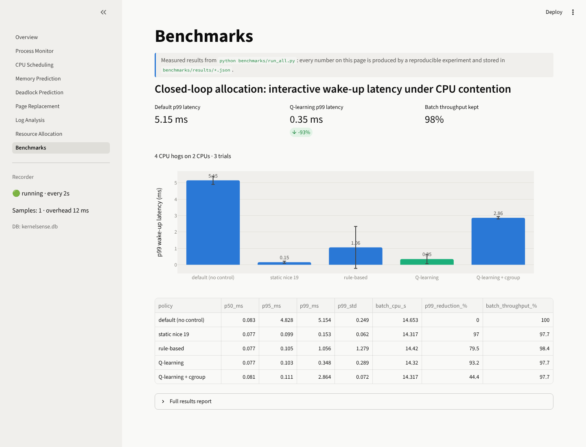
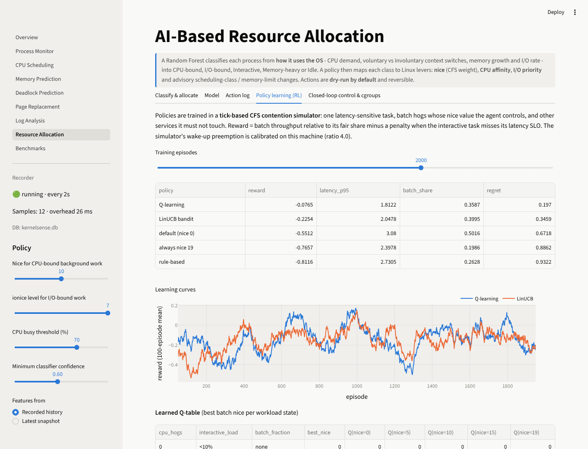
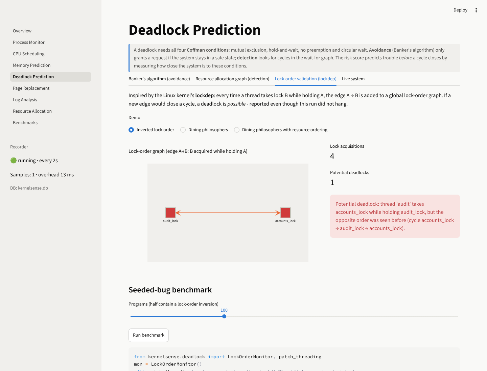
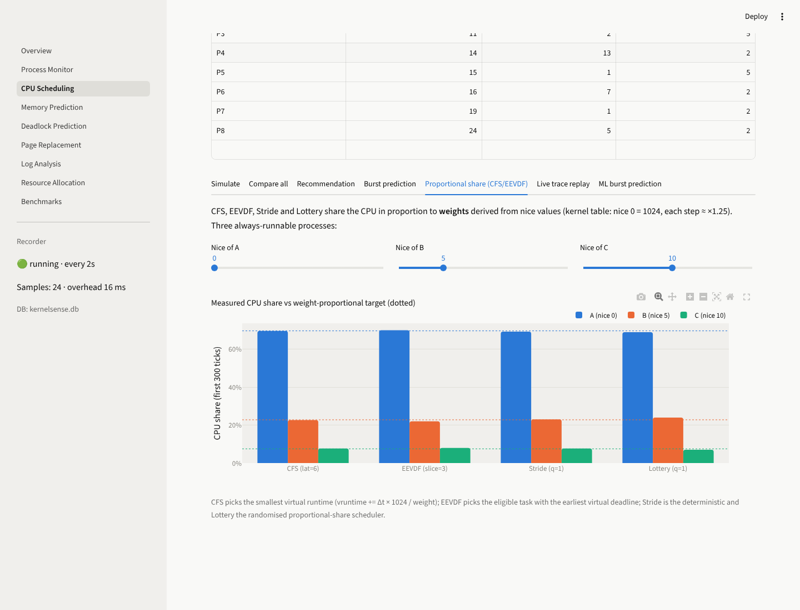

# KernelSense

**Intelligent Operating System Analytics and Resource Management Platform.** A Python platform that reads the
Linux kernel directly through `/proc`, PSI and cgroups. It replays real workloads through from-scratch
implementations of OS algorithms, predicts resource behaviour with machine learning, and controls running processes
in a closed loop. Every claim is backed by a reproducible benchmark.


## Headline results

Measured on a 2-CPU Linux 6.x VM. Reproduce with `python benchmarks/run_all.py`; full report:
[benchmarks/RESULTS.md](benchmarks/RESULTS.md).

| Area | Result |
|---|---|
| Closed-loop allocation | Learned Q-learning policy cut p99 wake-up latency of a latency-sensitive task from **5.15 ms to 0.35 ms (−93%)** under 2× CPU oversubscription while keeping **98%** of batch throughput |
| Kernel data layer | Pure `/proc` collector **2.5× faster than psutil** (7.1 vs 17.7 ms per full sample); recorder uses **0.4% CPU** at 2 s sampling |
| OOM prediction | Recomputed `oom_score` from `/proc/[pid]/status` using the kernel's formula matches the kernel **exactly (±1) for 100%** of user processes |
| Deadlock prediction | Lockdep-style lock-order validation detected **100% of 100 seeded lock-order bugs with 0 false positives**; none of those bugs actually deadlocked during testing |
| Page replacement | Mattson single-pass LRU miss curve **matches simulation exactly**, 34× faster; tiled matmul: **24 vs 1,970** page faults; ARC matches Optimal on scan workloads where LRU/FIFO/Clock thrash |
| Burst prediction | Gradient boosting cut next-CPU-burst MAE by **46%** versus exponential averaging on held-out sequences |
| Memory | Leak detection F1 **0.96** (Mann-Kendall + sustained-growth test); best forecaster cuts MAPE on leaking processes by **53%** versus naive |
| Logs | Drain template mining: grouping accuracy **0.97 (BGL), 0.998 (HDFS), 0.69 (Linux)** on Loghub; Isolation Forest window anomaly F1 **0.79** on BGL |

<table>
<tr>
<td></td>
<td></td>
</tr>
<tr>
<td></td>
<td></td>
</tr>
<tr>
<td></td>
<td></td>
</tr>
</table>

---

## Architecture

```
┌─────────────────────────────────────────────────────────────────────────────┐
│ Interfaces   Streamlit dashboard · CLI · Prometheus exporter + Grafana        │
├─────────────────────────────────────────────────────────────────────────────┤
│ Control      closed-loop controller (observe → decide → act → measure)        │
│              nice / CPU affinity / ionice / cgroup v2 (v1 fallback)           │
│              safety: dry-run, allow-list, PSI-based rollback, audit log       │
├─────────────────────────────────────────────────────────────────────────────┤
│ Learning     calibrated CFS contention simulator → Q-learning / LinUCB        │
│              Random Forest workload classifier · quantile GBM forecaster      │
│              gradient-boosted burst predictor · Isolation Forest · n-gram     │
├─────────────────────────────────────────────────────────────────────────────┤
│ Engines      scheduling (FCFS…MLFQ, CFS, EEVDF, Stride, Lottery, trace replay)│
│              memory (forecast, leak, OOM victim) · deadlock (Banker's, RAG,   │
│              lockdep) · paging (FIFO…ARC, WSClock, Mattson, real traces) ·    │
│              logs (Drain, events, DeepLog rule, incident correlation)         │
├─────────────────────────────────────────────────────────────────────────────┤
│ Storage      SQLite time-series store                                         │
├─────────────────────────────────────────────────────────────────────────────┤
│ Collectors   pure /proc collector: stat, status, smaps_rollup, oom_score,     │
│              loadavg, vmstat, meminfo, pressure, locks · burst tracer ·       │
│              journald/syslog/dmesg · optional eBPF run-queue latency          │
└─────────────────────────────────────────────────────────────────────────────┘
                                   Linux kernel
```

Design rules:

* **The UI holds no OS logic.** Every algorithm lives in the `kernelsense` package; the dashboard, CLI and exporter
  only call it.
* **Pluggable interfaces:** `Collector`, `Scheduler`, `ReplacementPolicy` and `Forecaster`.
* **Graceful degradation.** A capability probe checks PSI, cgroup v1/v2, `/proc/locks`, smaps_rollup, BTF and
  bpftrace, and skips features the kernel does not offer.
* **Measured, not claimed.** Every ML component is compared with a non-ML baseline on held-out data, and the
  closed-loop controller is evaluated against default Linux behaviour.

---

## Modules

### 1. Process monitoring
* Pure `/proc` collector. Process CPU% comes from `utime + stime` jiffy deltas, system and per-core CPU from
  `/proc/stat`, and memory from `MemAvailable`. Context switches, faults, I/O, file descriptors and the process tree
  are also collected.
* Workload classification from voluntary vs involuntary context switches.
* Anomaly detection: zombies, D-state, orphans, fork storms, and FD or thread explosions.
* RSS/PSS/USS from `smaps_rollup`, plus `oom_score`, in the process detail view.

### 2. CPU scheduling
* FCFS, SJF, SRTF, Round Robin, Priority with aging, and MLFQ with priority boost.
* Kernel-style proportional share:
  - **CFS**: vruntime, the kernel's nice-to-weight table, sched_latency and min_granularity.
  - **EEVDF**: lag-based eligibility and earliest virtual deadline.
  - **Stride** and **Lottery**.
* Metrics: waiting, turnaround and response time; p95/p99; throughput; utilisation; context switches; Jain's
  fairness index.
* **Live burst tracing.** CPU-time counters are sampled to segment real CPU bursts, which are replayed as a
  scheduling workload.
* Next-burst prediction: exponential averaging vs gradient boosting (walk-forward, held out).
* Goal-based recommender (balanced, interactive, throughput or fairness) with Linux mappings.

### 3. Memory usage prediction
* Forecasters: naive, moving average, linear trend, Holt, and quantile gradient boosting with 5/50/95% intervals.
  Each is evaluated against the naive baseline, and the best is auto-selected.
* Leak detection: trend slope and R², Mann-Kendall significance, and a sustained-growth test that rejects step
  changes.
* **OOM victim prediction**: the kernel's own `oom_score` formula, combined with the forecast exhaustion time.

### 4. Deadlock prediction
* Banker's algorithm (safety and request), resource allocation graphs (single and multi-instance), and a risk
  score.
* Live wait-for graph from `/proc/locks`.
* **Lock-order validation (lockdep):** a global lock-order graph flags a potential deadlock the moment an
  acquisition would close a cycle, even if the run never hangs. `patch_threading()` validates unmodified code.

### 5. Page replacement
* FIFO, LRU, Optimal, LFU, Clock, **ARC** (adaptive, scan-resistant) and **WSClock**.
* **Mattson's stack algorithm**: a one-pass LRU miss-ratio curve for every memory size, plus a reuse-distance
  histogram.
* Realistic traces:
  - algorithmic, computed from array addresses (row vs column-major, naive vs tiled matmul, binary search,
    quicksort, pointer chasing);
  - real binaries via Valgrind `lackey`.
* Belady's anomaly search and working-set/thrashing analysis.

### 6. Log analysis
* Parsers for syslog, journald and dmesg, and OS event rules (OOM, panic, lockup, hung task, segfault, I/O error,
  thermal throttling, and others).
* **Drain** template mining, a DeepLog-style next-template model (n-gram, top-k rule), and an Isolation Forest over
  time windows.
* **Incident correlation**: metric anomalies (robust z-score) matched to OS events to build a narrated timeline.
* Evaluation on **Loghub** (BGL, HDFS, Linux).

### 7. Performance dashboard and observability
* Streamlit dashboard: an overview plus eight pages, including **Benchmarks**.
* Dependency-free **Prometheus exporter** (`kernelsense export`) and a **Grafana** dashboard (`grafana/`).
* Optional **eBPF** run-queue latency histogram via `bpftrace` (`python -m kernelsense.ebpf`).

### 8. AI-based resource allocation
* Random Forest workload classifier (cross-validated, with feature importances) and a policy mapping classes to
  nice, affinity and ionice.
* **cgroup manager**: v2 `cpu.weight`, `cpu.max`, `memory.high`/`max`, with a v1 fallback.
* **Calibrated contention simulator.** A tick-based CFS model with slices, sleeper credit and weighted wakeup
  preemption. Its preemption parameter is fitted to wake-up latency measured on the machine.
* **LinUCB** contextual bandit and **tabular Q-learning**, trained in simulation and evaluated on held-out scenarios
  against fixed baselines.
* **Closed-loop controller.** It observes per-CPU contention, applies the learned batch priority via nice or a
  cgroup, and rolls back when CPU pressure (PSI) worsens.

---

## Getting started

Requirements: **Linux** (native, VM or WSL2) and **Python 3.10+**.

```bash
git clone https://github.com/Kislay01/Intelligent-Operating-System-Analytics-and-Resource-Management-Platform.git
cd Intelligent-Operating-System-Analytics-and-Resource-Management-Platform
python3 -m venv .venv && source .venv/bin/activate
pip install -r requirements.txt

streamlit run Overview.py              # dashboard on http://localhost:8501
python benchmarks/run_all.py           # reproduce every reported number (~5-8 min)
python -m pytest -q                    # 109 tests incl. property-based tests
```

**Root and cgroups.** Raising a nice value works for your own processes. Lowering it, and the cgroup actuation
mode, need root or a delegated cgroup. The benchmark runs every mode the machine supports.

**WSL2.** Everything except eBPF works. Enable systemd for journald (`[boot]` / `systemd=true` in `/etc/wsl.conf`)
and check PSI with `cat /proc/pressure/cpu`. Only processes inside the WSL VM are visible.

| Variable | Default | Meaning |
|---|---|---|
| `KS_COLLECTOR` | `auto` | `procfs` (pure /proc, default on Linux) or `psutil` |
| `KS_SAMPLE_INTERVAL` | `2` | seconds between samples |
| `KS_RETENTION_HOURS` | `24` | metric retention |
| `KS_MEM_ALERT_PCT` | `90` | memory alert threshold |
| `KS_DRY_RUN` | `1` | set `0` to let `allocate --apply` change processes |
| `KS_DATA_DIR` | `./data` | database, models, calibration, action log |

---

## Live demo

```bash
bash workloads/run_demo.sh 180
```

| Workload | Shows |
|---|---|
| `cpu_hog.py` | CPU-bound classification, nice/affinity/cgroup actions |
| `memory_leak.py` | Leak detection, memory forecast, OOM victim ranking |
| `io_heavy.py` | I/O-bound classification, ionice |
| `zombie_maker.py` | Zombie anomaly |
| `lock_deadlock.py` | Real circular wait in `/proc/locks` |
| `latency_probe.py` | Wake-up latency under contention (used by the allocation benchmark) |

## CLI

```bash
python -m kernelsense status                     # collector, capabilities, top processes, anomalies
python -m kernelsense record --duration 600      # record metrics headless
python -m kernelsense trace --duration 5         # capture CPU bursts and replay them through the schedulers
python -m kernelsense schedule --profile convoy --goal interactive --practical
python -m kernelsense paging --trace matmul_naive --frames 8
python -m kernelsense bankers --request "P1 1 0 2"
python -m kernelsense lockdep                    # lock-order validation demos + seeded-bug benchmark
python -m kernelsense oom                        # OOM-killer victim ranking
python -m kernelsense logs --source auto
python -m kernelsense loghub                     # Drain + anomaly detection on Loghub
python -m kernelsense allocate [--apply]         # classify workloads, plan nice/affinity/ionice
python -m kernelsense control --batch-pids 123 456 --interactive-pids 789 --policy q --mode cgroup
python -m kernelsense export --port 9877         # Prometheus /metrics
```

## Project structure

```
kernelsense/
├── monitoring/   procfs.py · procfs_collector.py · collector.py · classify.py · analysis.py
├── scheduling/   algorithms.py · proportional.py (CFS, EEVDF, Stride, Lottery) · trace.py · ml_burst.py
│                 burst_predictor.py · workload.py · recommender.py · models.py
├── memory/       forecast.py (incl. quantile GBM) · leak.py (Mann-Kendall) · oom.py
├── deadlock/     bankers.py · rag.py · risk.py · live.py · lockdep.py · seeded.py
├── paging/       algorithms.py · advanced.py (ARC, WSClock, Mattson) · traces.py · analysis.py
├── logs/         parser.py · events.py · anomaly.py · drain.py · sequence.py · correlate.py · loghub.py
├── allocator/    features.py · classifier.py · policy.py · actuator.py · cgroup.py · env.py · learning.py
│                 controller.py
├── bench/        experiments.py · report.py
├── exporter.py · ebpf.py · recorder.py · storage.py · cli.py
Overview.py, pages/      Streamlit dashboard
benchmarks/              run_all.py, results/*.json, RESULTS.md
grafana/                 dashboard + Prometheus config
workloads/               demo and benchmark programs
tests/                   pytest + hypothesis
docs/                    OS concept notes, screenshots
```

## Limitations

* **Contention model.** The simulator models one CPU and a single preemption parameter fitted on the target
  machine. Learned policies should be re-calibrated (`benchmarks/run_all.py policy_learning`) on a different
  kernel or CPU count.
* **Static baseline.** In the allocation benchmark, a static nice 19 policy also performs well because no other
  services compete. The learned policy's advantage is that it keeps batch throughput in scenarios with competing
  services (see the simulator evaluation).
* **cgroup v1.** Under cgroup v1, `cpu.shares` acts on the group as a whole and reduced latency less than per-process
  nice (−44% vs −93%). cgroup v2 `cpu.weight` is preferred.
* **Synthetic training data.** The workload classifier's training set is synthetic, so its accuracy measures class
  separability, not real-world accuracy.
* **Loghub sample size.** The 2k-line Loghub samples are small. The n-gram model reaches recall 1.0 on BGL but low
  precision because only a few normal windows are available for training.
* **eBPF.** Requires `bpftrace` and root, and is optional.

See [docs/os-concepts.md](docs/os-concepts.md) for the theory behind each module.
